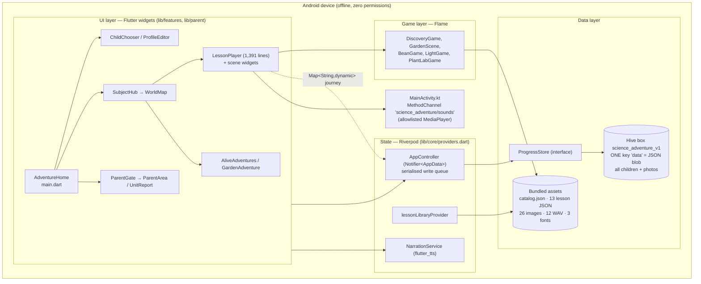
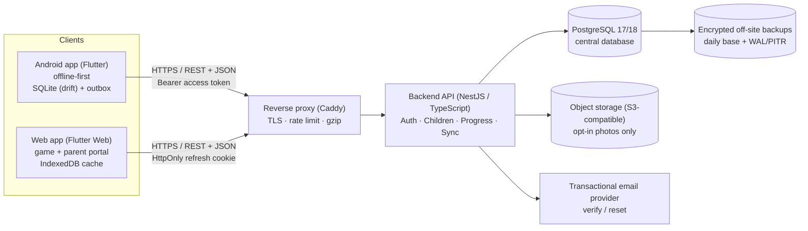
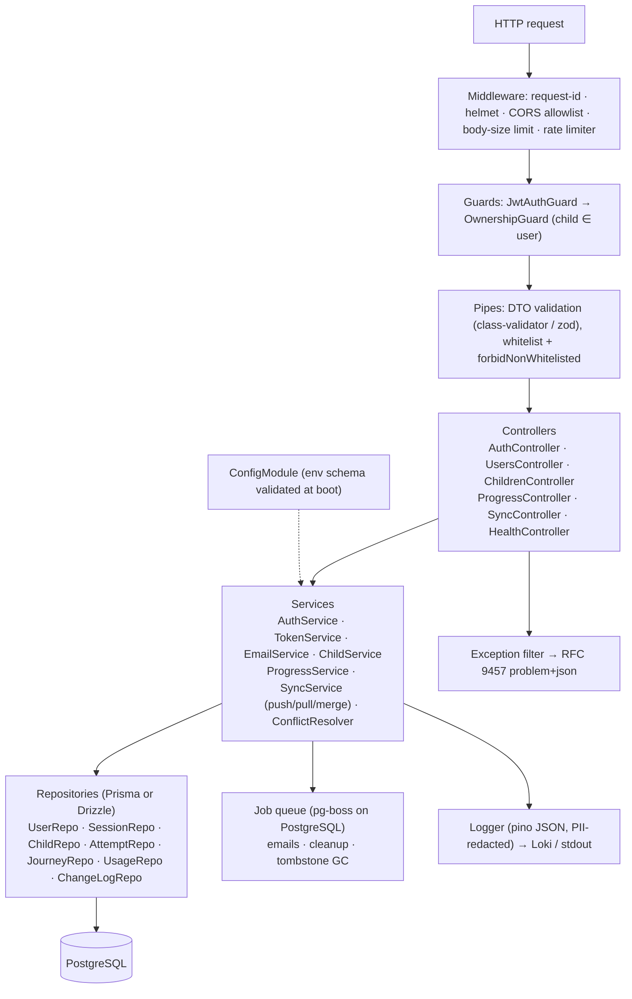
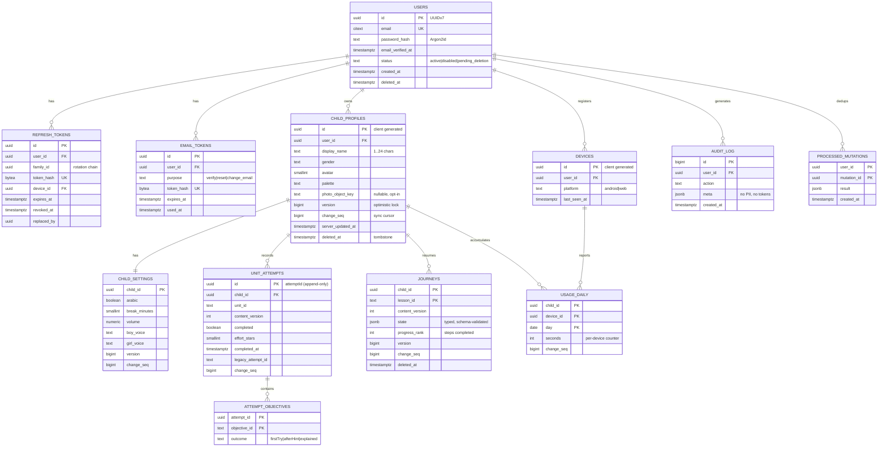
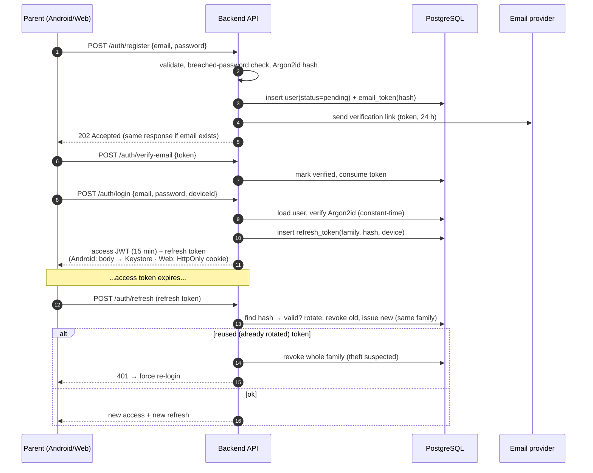
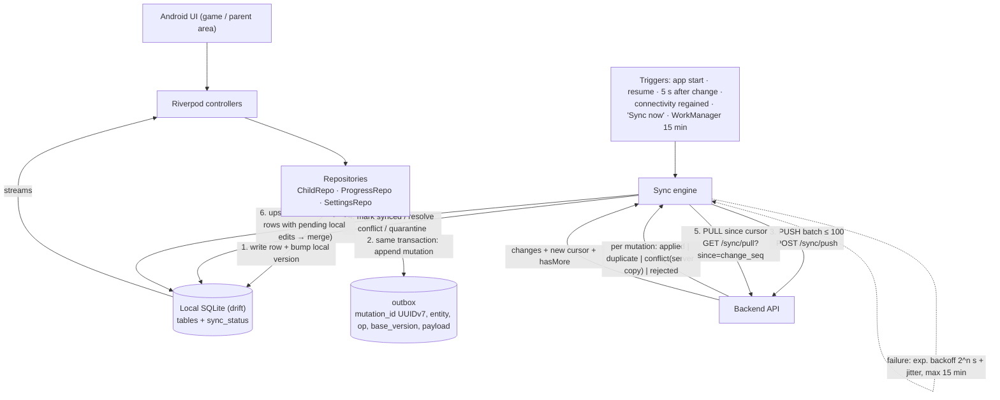
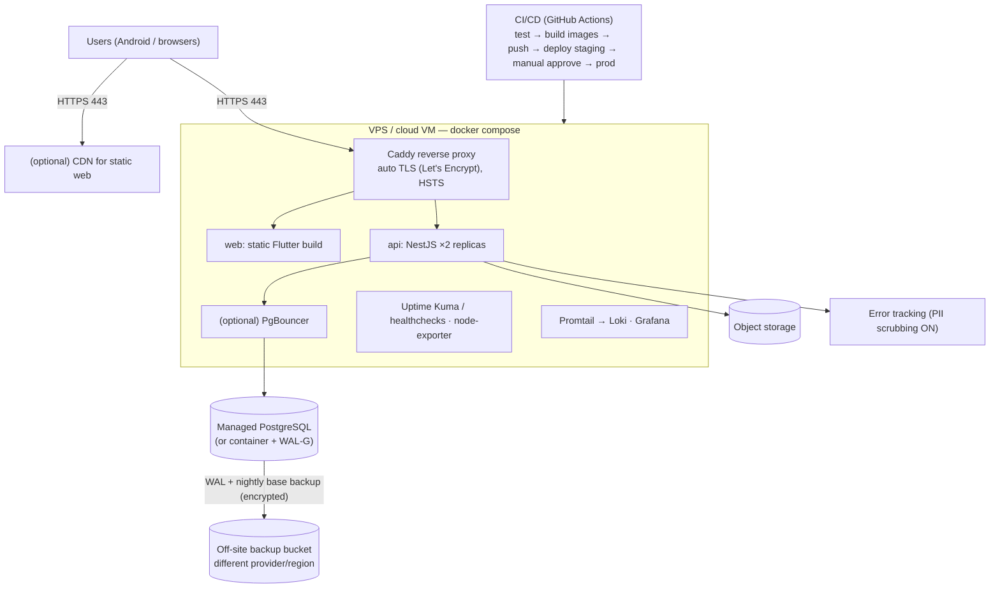
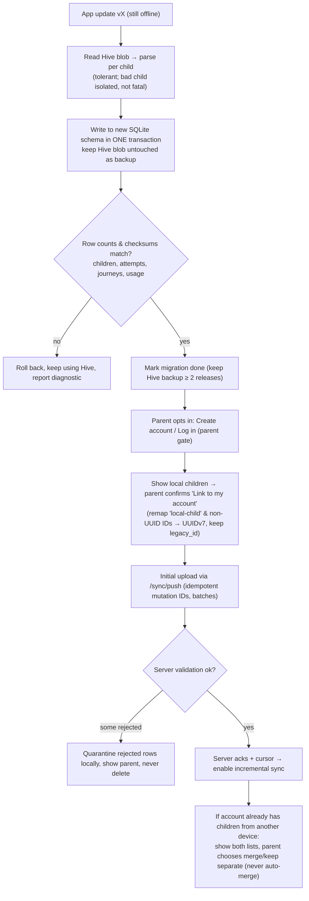

# Architecture Diagrams — Science Adventure

The diagrams use Mermaid, which renders on GitHub, GitLab, VS Code (with a Mermaid extension) and most Markdown viewers. Diagram 1 shows the **current** system as observed. Diagrams 2–9 show the **proposed** future system, which is design only and not built.

---

## 1. Current Android architecture (as observed)



**Layer dependencies observed.** UI → Riverpod → `ProgressStore` → Hive, and UI → assets directly. Domain rules (`AttemptRecorder`, `addUsage`, unlock rules) live in `core/models.dart` and `content/catalog.dart`, which is good. Migrations and scene logic, however, live inside widgets (`session.dart`, `lesson_player.dart`).

---

## 2. Target system architecture



---

## 3. Backend architecture (NestJS modular monolith)



---

## 4. Database architecture (ERD)



---

## 5. Authentication flow (register → verify → login → refresh)



---

## 6. Android sync flow (offline-first, outbox)



---

## 7. Web data flow (Flutter Web)

```mermaid
sequenceDiagram
  autonumber
  participant B as Browser (Flutter Web)
  participant API as Backend API
  participant DB as PostgreSQL
  B->>API: POST /auth/login (credentials: include)
  API-->>B: Set-Cookie refresh (HttpOnly; Secure; SameSite=Strict; Path=/api/v1/auth)<br/>body: access token (kept in memory only)
  B->>API: GET /sync/pull?since=0 (Bearer access)
  API->>DB: SELECT … WHERE user_id = :sub AND change_seq > 0
  API-->>B: children, settings, attempts, journeys, usage + cursor
  B->>B: cache in IndexedDB (non-sensitive progress only)
  B->>API: POST /sync/push [{mutationId, PATCH child, baseVersion: 7}]
  API->>DB: UPDATE … WHERE id=:id AND user_id=:sub AND version=7
  alt version matches
    API-->>B: applied, version 8, change_seq N
  else version mismatch
    API-->>B: conflict + server copy → field-level merge / ask parent
  end
  Note over B,API: Android pulls since its cursor and receives change N
```

---

## 8. Deployment architecture (Docker Compose, no Kubernetes)



---

## 9. Existing local data migration flow (zero data loss)


