# Development Roadmap — Android + Web + Backend + Central Database

**This is a plan only. Nothing in it has been built.** It is derived from the audit of commit `9fbdaf4` on 2026-10-04.

## Why the order differs from the generic template

1. **The local data layer comes before the backend.** Today all state is one untyped JSON blob in Hive (AUD-003, AUD-004). Sync cannot be built safely on top of that, so the Android refactor and the local database migration must come before backend integration.
2. **The privacy decision comes first.** The product decision *"no accounts, no data sending"* has to be formally revised before any server work (REC-01). It affects scope, legal duties and whether the app may request `INTERNET` at all.
3. **Backend and authentication are one phase.** In this product every endpoint is per-parent, so authentication is the backend's foundation.
4. **The web client reuses Flutter.** The codebase already compiles for web (conditional imports, a working preview). A Flutter Web client reuses the whole game, so the "Web App" phase is much smaller than a separate React rebuild would be.

## Priority legend

P0 critical / blocking · P1 high · P2 medium · P3 enhancement

## Complexity legend

S · M · L · XL, relative only. **Calendar durations are not given.** Team size, availability and the scope of the parent portal are unknown, so any estimate in weeks would be false precision. After Phase 0, re-estimate with the real team.

---

## Phase 0: Preparation, safety net and reproducible builds — **P0**

| | |
|---|---|
| **Objective** | Anyone (and CI) can build and test the app from a clean checkout. Current data and signing are protected. |
| **Tasks** | Tag the current release; full backup of the repo and `.tools`. Add CI: `pub get --enforce-lockfile` → `dart analyze --fatal-infos` → `flutter test` → `flutter build apk` → content validators. Pin Flutter through CI or FVM. Create the **release upload key** and two offline backups, and enrol in Play App Signing. Build a release AAB with `--obfuscate --split-debug-info`. Run the first physical-device test pass on a low-RAM tablet. |
| **Dependencies** | None |
| **Risks** | Losing the signing key means updates are impossible. Debug→release certificate change forces reinstall (README warns). |
| **Complexity** | M |
| **Skills** | Flutter build, Android signing, CI (GitHub Actions) |
| **Deliverables** | Green CI pipeline, signed release AAB, device test report, key-custody document |

## Phase 1: Fix critical existing issues and decide privacy — **P0 / P1**

| | |
|---|---|
| **Objective** | Stabilise the current offline app and remove blockers for the web target. Formally decide on accounts and data handling. |
| **Tasks** | AUD-005: fix the web delete-child bug (`nextInt(1 << 32)`) and add provider tests and web test runs. AUD-006: last-good backup snapshot and per-child tolerant parsing. AUD-009: accurate error messages plus local privacy-safe logging. AUD-019: voice reset. AUD-018: UI polish quick wins. AUD-012: remove dead code and move source art out of Git. AUD-013: adopt `flutter_lints`. **Privacy:** parental consent model, privacy policy, data inventory, retention, legal review for the target countries (REC-01, REC-03). |
| **Dependencies** | Phase 0 (CI to catch regressions) |
| **Risks** | Legal review may narrow scope, for example forbidding photo sync. |
| **Complexity** | M |
| **Skills** | Flutter, QA, privacy/legal adviser |
| **Deliverables** | Patch release, signed-off privacy decision record, updated `PRODUCT_DECISIONS.md` |

## Phase 2: Android refactor (domain + repository + local database) — **P0**

| | |
|---|---|
| **Objective** | Typed domain models and a repository layer over a relational local database. This is the foundation for sync. |
| **Tasks** | Typed models (freezed/json_serializable) for lessons, steps and per-scene journey state, checked against `schemas/` (AUD-003). Split `LessonPlayer` into a controller plus scene renderers (AUD-002). Versioned migration registry (AUD-007). Replace the Hive blob with **drift/SQLite** tables and a local Hive→SQLite migration with checksums and the Hive backup kept (diagram 9). Usage buffering (60 s). Photos as files. Bounded image cache and lossy WebP assets (AUD-008). ARB localisation (AUD-011). |
| **Dependencies** | Phase 1 |
| **Risks** | Losing data during the local migration → mitigated by dry-run, checksums, rollback, and keeping Hive for 2 releases. Regressions in scenes → existing 203 tests plus new golden tests. |
| **Complexity** | XL (largest single phase) |
| **Skills** | Senior Flutter, SQLite/drift, testing |
| **Deliverables** | Refactored app release with identical behaviour, migration test matrix, new test suites |

## Phase 3: Data model and API contract design — **P1**

| | |
|---|---|
| **Objective** | Fix the server schema and the OpenAPI 3.1 contract before writing server code. |
| **Tasks** | Finalise the ERD (see `Architecture_Diagrams.md` §4). Choose UUIDv7 for IDs. Define the sync protocol (push/pull, cursors, tombstones, idempotency). Write the OpenAPI spec. Generate the Dart client. Write conflict rules per entity. Write the threat model (STRIDE) for auth and sync. |
| **Dependencies** | Phase 2 (typed local models = contract source) |
| **Risks** | Designing sync semantics too late → that is why this is a separate phase |
| **Complexity** | M |
| **Skills** | Architect, DB architect, security engineer |
| **Deliverables** | `openapi.yaml`, ERD, sync spec, threat model |

## Phase 4: Backend core and authentication — **P1**

| | |
|---|---|
| **Objective** | Production-grade NestJS API with email auth and per-parent data isolation. |
| **Tasks** | NestJS modular monolith, PostgreSQL, Prisma/Drizzle migrations. Register, verify, login, refresh with rotation and reuse detection, logout, logout-all, forgot/reset/change password, delete account. Argon2id. Rate limits. Ownership guard (BOLA/IDOR tests). Problem+json errors. pino logging with redaction. Health endpoints. Docker images. |
| **Dependencies** | Phase 3 |
| **Risks** | Auth bugs → use proven libraries, write security tests, external review in Phase 8 |
| **Complexity** | L |
| **Skills** | Backend (TypeScript/NestJS), PostgreSQL, security |
| **Deliverables** | API service with ≥ 80 % service test coverage, auth test suite, Docker Compose dev stack |

## Phase 5: Android API integration (accounts optional) — **P1**

| | |
|---|---|
| **Objective** | Parents can create an account or log in from the parent area. The game stays fully playable offline. |
| **Tasks** | Add the `INTERNET` permission (per the Phase 1 decision). Generated API client. `flutter_secure_storage` for tokens. Auth screens behind the parent gate. Network security config (HTTPS only, no user CAs). Environment flavours (dev/staging/prod). |
| **Dependencies** | Phase 4 |
| **Risks** | Loss of the "zero permissions" trust signal → communicate clearly and keep accounts optional |
| **Complexity** | M |
| **Skills** | Flutter, mobile security |
| **Deliverables** | App release with optional account |

## Phase 6: Synchronisation — **P1**

| | |
|---|---|
| **Objective** | Bidirectional, offline-first sync with no silent data loss. |
| **Tasks** | Outbox, sync engine, triggers, WorkManager periodic job. Server push/pull endpoints with idempotency. Conflict resolver per entity (see the future architecture doc). Tombstones and GC. Initial upload of existing local data (diagram 9). "Sync now" plus sync status in the parent area. |
| **Dependencies** | Phase 5 |
| **Risks** | Hardest part technically → property-based tests, two-device simulations, chaos tests (offline, kill mid-sync) |
| **Complexity** | XL |
| **Skills** | Distributed-systems thinking, Flutter, backend |
| **Deliverables** | Sync spec implemented, multi-device test report |

## Phase 7: Web application — **P2**

| | |
|---|---|
| **Objective** | The same parent logs in on a computer, sees and edits the same data, and children can play in the browser. |
| **Tasks** | Flutter Web target (`main_web.dart`), cookie-based refresh, IndexedDB cache, responsive parent portal (children, settings, reports, account), CSP headers, web-specific tests. Optional: a Next.js marketing / legal site if SEO is needed. |
| **Dependencies** | Phase 6 (sync API), Phase 1 web bug fixes |
| **Risks** | Flutter Web bundle size and first load (≈ 4 MB JS plus assets) → deferred loading, cache headers |
| **Complexity** | M–L |
| **Skills** | Flutter Web, web security |
| **Deliverables** | Deployed web app on staging |

## Phase 8: Security hardening — **P1**

Tasks: external penetration test of API, auth and sync. Dependency scanning (osv-scanner, npm audit, Dependabot). Secret scanning. Header review. Backup restore drill. Privacy review. Incident response runbook. · Dependencies: Phases 4–7 · Complexity: M · Deliverables: pentest report and fixes.

## Phase 9: Testing and QA — **P1**

Tasks: integration tests on devices (Firebase Test Lab or a device farm), golden tests, load test for sync endpoints (k6), accessibility audit (TalkBack, contrast, text scale 200 %), usability sessions with children and parents. · Complexity: M–L.

## Phase 10: Staging — **P1**

Production-like environment, synthetic data only (never real child data), release-candidate builds, Play closed testing track. · Complexity: S–M.

## Phase 11: Production — **P1**

Gradual rollout (Play staged rollout 5 % → 100 %), monitoring dashboards, on-call, backup verification, rollback plan. · Complexity: M.

## Continuous / P3 enhancements

Google and Microsoft sign-in (OIDC) for parents. Multi-parent households (invite a co-parent). Photo sync opt-in (encrypted). Teacher or classroom mode. Analytics only if privacy-preserving and consented.

---

## Dependency graph

```mermaid
flowchart LR
  P0[Phase 0 Prep/CI] --> P1[Phase 1 Fixes + Privacy]
  P1 --> P2[Phase 2 Android refactor + local DB]
  P2 --> P3[Phase 3 Schema + API contract]
  P3 --> P4[Phase 4 Backend + Auth]
  P4 --> P5[Phase 5 Android integration]
  P5 --> P6[Phase 6 Sync]
  P6 --> P7[Phase 7 Web app]
  P4 --> P8[Phase 8 Security hardening]
  P7 --> P8
  P8 --> P9[Phase 9 QA]
  P9 --> P10[Phase 10 Staging]
  P10 --> P11[Phase 11 Production]
```

## Top 10 recommended actions (in order)

1. Set up CI and a reproducible toolchain, then protect the release signing key (AUD-001, SEC-06).
2. Formally revise the privacy decision: parent-owned accounts, consent, no photo sync by default (REC-01, REC-03).
3. Fix the web delete-child bug and add web-platform and provider-level tests (AUD-005, AUD-010).
4. Add save-data resilience: last-good backup, per-child tolerant parsing, accurate errors and logging (AUD-006, AUD-009).
5. Introduce typed domain models and a repository layer, and remove `Map<String, dynamic>` state (AUD-003).
6. Split `LessonPlayer` into a controller plus scene renderers, and move migrations into a tested registry (AUD-002, AUD-007).
7. Replace the Hive blob with SQLite (drift) plus an outbox, migrating locally with zero data loss (AUD-004).
8. Optimise assets (lossy WebP, bounded cache, AAB splits) and profile on a low-RAM device (AUD-008).
9. Design the OpenAPI contract and sync protocol, then build NestJS + PostgreSQL with email auth (Argon2id, rotating refresh tokens).
10. Ship optional accounts on Android, then sync, then Flutter Web, each behind a security review.
